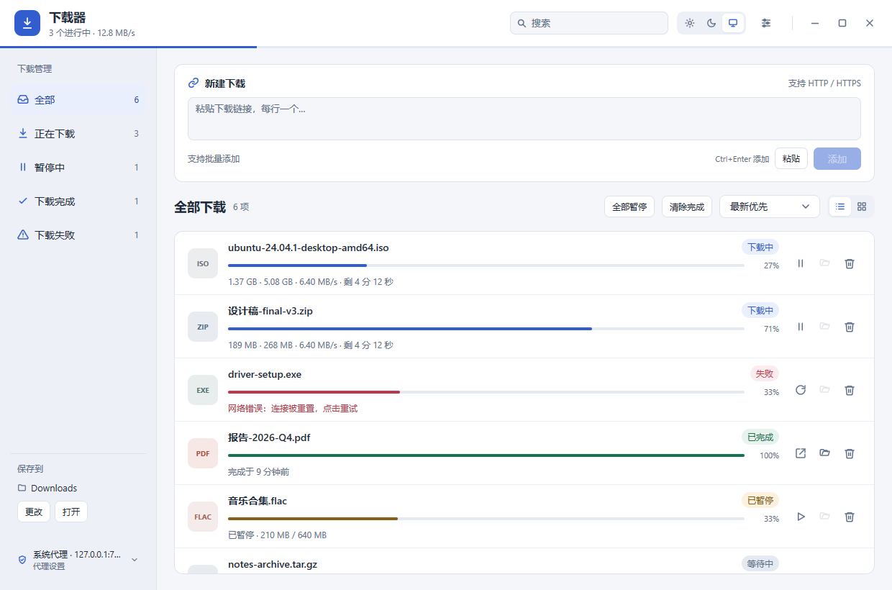
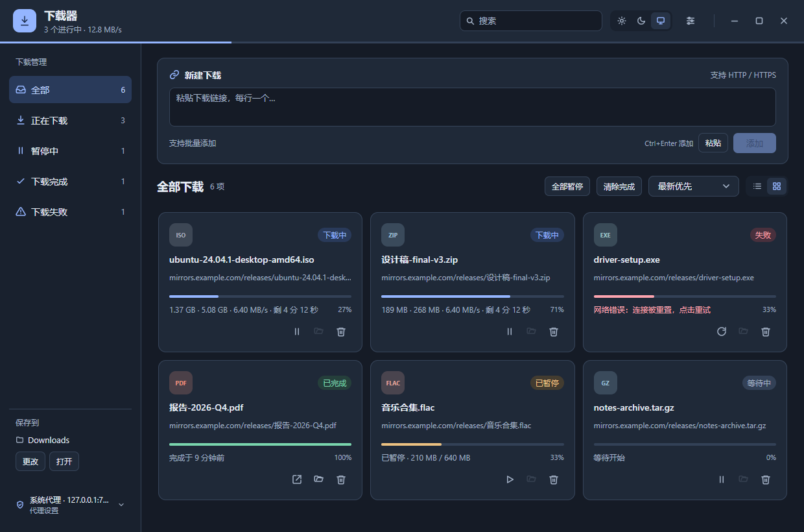

# 下载器 · Downloader

一个用 Go 与 [MyGo](https://github.com/egoist/mygo) **原生 UI** 编写的桌面下载器：窗口由 MyGo 自己绘制（Windows 上是 Direct3D 11），不启动 WebView，没有 HTML/JavaScript 前端，打开即用、占用低。当前基于 MyGo 0.7.0。

界面为简体中文，支持深色 / 浅色 / 跟随系统，以及列表与卡片两种文件管理方式。浅色主题采用冷灰底色与白色面板，深色主题采用分层石板灰，统一使用蓝色强调操作与选中状态。列表通过细分隔线组织任务，完成、暂停与失败在状态标签和进度条中保持一致的语义色。





## 功能

- **从链接下载**：粘贴一条或多条 HTTP/HTTPS 链接；自动补全 `https://`，跟随重定向，从 `Content-Disposition`、URL 或 `Content-Type` 推断文件名；支持 URL 内嵌的用户名/密码（Basic Auth）。
- **批量与并发**：一次添加多条链接，按设定的并发数排队下载；支持全部暂停 / 全部继续。
- **代理**：
  - 无代理（直连）
  - 系统代理：Windows 读取 WinINet 注册表，macOS 读取 `scutil --proxy`，同时读取 `HTTP_PROXY` / `HTTPS_PROXY` / `ALL_PROXY` / `NO_PROXY` 环境变量
  - 自定义代理：HTTP、HTTPS、SOCKS5，支持用户名/密码与跳过列表（`localhost`、`*.local`、`10.0.0.0/8` 等），可一键测试连接
- **保存目录**：默认系统下载文件夹，可在设置中选择并校验可写；新任务即时使用新目录。
- **文件管理**：列表 / 卡片切换、搜索、状态筛选、排序、多选批量操作、双击或点击打开文件、在文件夹中显示、复制链接或保存路径、从列表移除、删除文件。
- **断点续传**：HTTP Range + `If-Range`，下载中的数据保存在 `<文件名>.part`，元信息在同名 `.part.meta`；暂停、退出、应用重启后都能继续。服务器不支持 Range、没有可用的强 ETag/Last-Modified、文件版本变化或分段不匹配时，会自动从头重下，避免拼接不同版本的数据。
- **体验**：自定义标题栏与窗口按钮，支持拖动、双击最大化/还原和 Windows 11 贴靠布局；深/浅色与跟随系统、下载完成系统通知、添加后自动开始（关闭时新任务以暂停状态加入）、并发数设置，两个主题都经过逐帧渲染检查。
- **中文优先**：应用文案为中文，MyGo 自带的控件、菜单与对话框也通过 `zh-Hans` 语言包显示中文。

## 运行与构建

需要 Go 1.27.3 或更高版本。原生 UI 不需要 Bun、Node、cgo 或前端构建。

```sh
# 直接运行
go run .

# 开发（文件变化自动重建并重启）
go tool mygo dev

# 运行测试
go test ./...

# 打包为当前平台的安装包
go tool mygo build
# 产物在 build/<os>-<arch>/：
#   Windows: Downloader.exe 与 downloader-setup-0.1.0-amd64.exe
#   macOS:   Downloader.app 与 .dmg
#   Linux:   可执行文件、.desktop、图标与 .deb
```

跨平台打包：

```sh
go tool mygo build -platform windows/amd64,darwin/universal,linux/amd64
```

平台要求：Windows 10/11 无需额外组件；macOS 12+；Linux 需要 GTK 3（不需要 WebKitGTK，因为应用没有网页）。

## 使用

1. 在顶部输入框粘贴链接，每行一个；点击「添加」或按 `Ctrl/Cmd + Enter`。
2. 在侧边栏切换「全部 / 正在下载 / 暂停中 / 下载完成 / 下载失败」，用顶部搜索框过滤。
3. 每一行右侧：暂停/继续/重试、在文件夹中显示、移除；右键还有复制链接、复制路径、删除文件等。
4. 设置（齿轮或 `Ctrl/Cmd + ,`）：
   - 常规：保存位置、同时下载数、完成通知、添加后自动开始
   - 代理：无代理 / 系统代理 / 自定义；可查看系统代理探测结果、重新检测、测试连接
   - 外观：浅色 / 深色 / 跟随系统，默认列表或卡片
   - 关于：版本、数据目录、开源框架链接

快捷键：`Ctrl/Cmd + Enter` 添加，`Ctrl/Cmd + ,` 设置，`Ctrl/Cmd + F` 搜索，`Ctrl/Cmd + V` 粘贴，列表内 `Ctrl/Cmd + A` 全选，`Esc` 关闭弹窗或清空搜索。

## 代理说明

- **系统代理**优先读取系统的原生设置；Windows 读取
  `HKCU\Software\Microsoft\Windows\CurrentVersion\Internet Settings` 的
  `ProxyEnable`、`ProxyServer`、`ProxyOverride`。若系统只配置了 PAC
  （`AutoConfigURL`），本应用不会执行 PAC 脚本，会回退到环境变量或直连，并在设置页说明。
- 环境变量支持大小写两种写法与 `ALL_PROXY`；`NO_PROXY`（或自定义的跳过列表）支持
  `<local>`、`*.example.com`、`.example.com`、`host:port`、CIDR 与 `*`。
- 代理设置**对之后开始的连接生效**，正在下载的任务不会被中断。
- 代理密码不会写入 `settings.json`：它保存在系统凭据库（Windows 凭据管理器 / macOS 钥匙串 /
  Linux Secret Service，密钥为 `proxy-password`）。凭据库不可用时，密码只在本次运行有效。
- 下载请求使用 `Accept-Encoding: identity`，避免压缩破坏 Content-Length 与 Range 语义。

## 断点续传与数据

- 下载中的内容写入 `<保存目录>/<文件名>.part`，旁边是记录 ETag / Last-Modified / 总大小的
  `.part.meta`。完成时用 `rename` 改名为最终文件并删除元信息。
- 应用每两秒把任务记录写入 `tasks.json`；退出时会把正在下载的任务置为暂停并保存。
- 数据文件位于系统的应用数据目录（Windows 通常是 `%AppData%\Downloader\`）：
  - `settings.json`：设置（不含代理密码）
  - `tasks.json`：下载记录
  - 损坏的设置或记录文件会被重命名为 `*.bad`，应用以默认值/空列表继续启动。
- 应用每两秒在后台检查已完成的文件；文件被外部移动或删除后，记录会显示「文件缺失」，可直接重新下载。
- 使用 `go run .` 与安装版时，应用数据目录可能因应用名不同而不同。

## 项目结构

```
main.go / app.go / deps.go     应用装配、生命周期、持久化与异步调度
view*.go                       原生 UI：自定义标题栏、侧边栏、添加卡、列表/卡片、设置与确认弹窗
style.go / icons.go / format.go 调色板、自定义 MyGo 主题、内联图标与格式化
internal/proxy                 代理配置、系统代理探测、HTTP/SOCKS5 传输
internal/download              下载队列、Range 续传、重试、文件名与任务记录
internal/settings, internal/store  设置类型与 JSON 持久化
scripts/make-icon.py           生成 resources/icon.png
```

## 测试与视觉快照

```sh
go test ./...                 # 单元测试与 ui.Tester 视图测试（不联网）
go vet ./...
CGO_ENABLED=0 go test ./...   # 纯 Go 构建验证
GOOS=linux go build ./...     # 跨平台编译检查
go tool mygo vet .            # 检查 UI 中保存的构建值
```

下载引擎的测试使用本地 `httptest` 服务器覆盖完整下载、暂停/继续、重启续传、服务器忽略 Range、
ETag 变化、并发上限、重试、404、0 字节、未知长度、基本认证、移除/删除与恢复；代理测试包含真实的
本地 HTTP 代理与最小 SOCKS5 服务器。

界面快照（浅/深 × 列表/卡片、选中状态、空状态、设置与确认弹窗，以及 960×640 最小窗口）用 `ui.Tester` 渲染真实像素：

```sh
DOWNLOADER_SNAPSHOT=1 go test -run TestSnapshots .
# 输出到 testdata/snapshots/
```

## 已知限制

- 不解析 PAC 脚本；不支持 BT/磁力、网页中的链接抓取、多连接分片下载、计划任务。
- 单窗口、单实例；退出应用会暂停进行中的下载（下次启动可继续）。
- 代理设置不作用于已经建立的连接。
- URL 内嵌的密码只保存在内存中，不写入磁盘；重启后重新添加带认证信息的同一链接，会为原暂停任务补回凭据，保留已有下载进度，并遵循「添加后自动开始」设置。
- 界面为简体中文；未提供多语言切换。

## 许可证

MIT。使用的框架为 [egoist/mygo](https://github.com/egoist/mygo)（MIT）。
